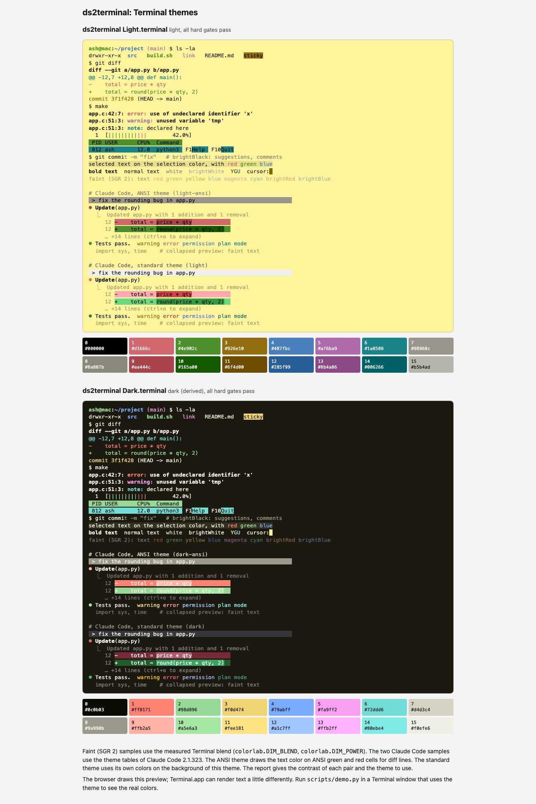
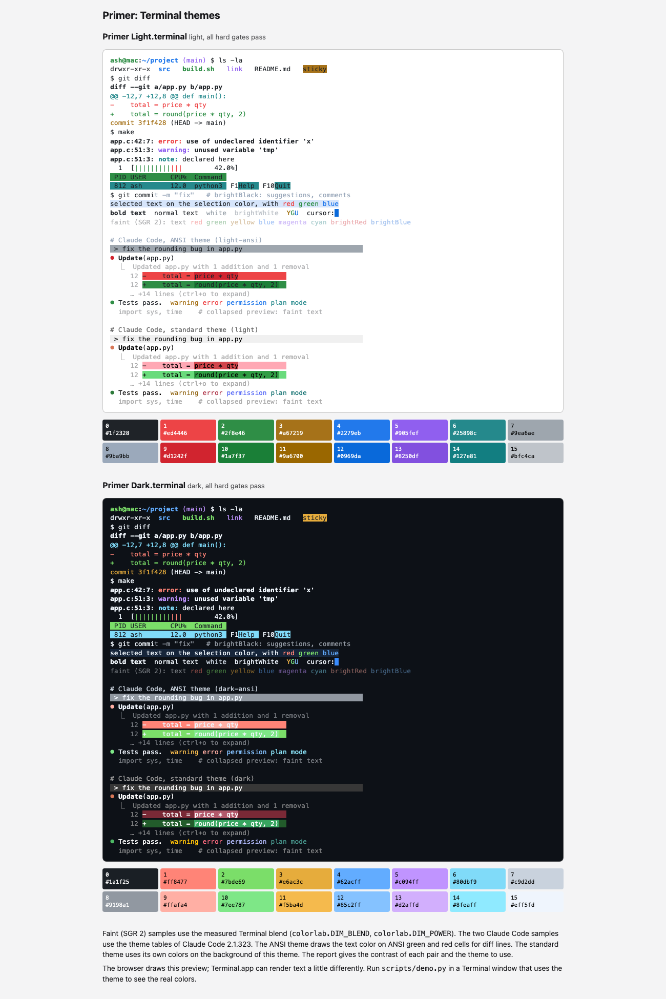
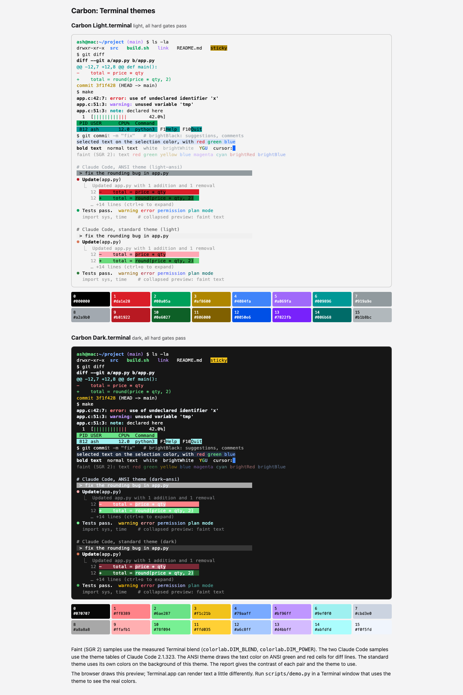
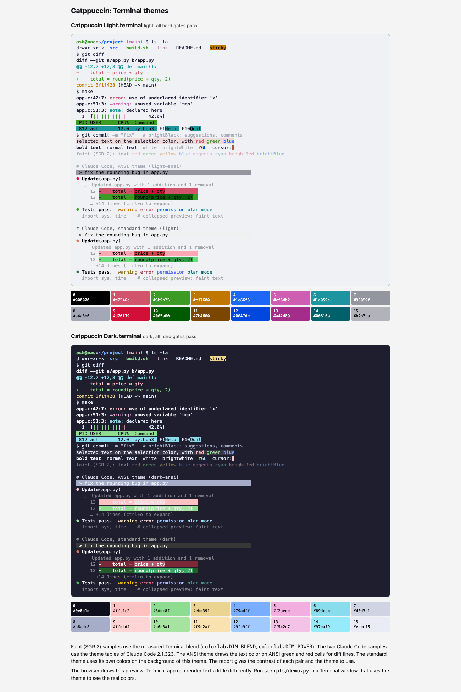

# Theme gallery

This folder holds Apple Terminal themes that `ds2terminal` made from public design-system token files. Each folder holds the design system and the themes made from it. The design-system input is a `design-system/` folder with unmodified copies of the upstream token files and the upstream license (the project's own theme uses `design-system/` at the repo root). A `SOURCE.md` names the repository, the commit and the file list. The themes are a light and a dark `.terminal` file, a `report.md` and `report.json` with every color, its source token and every repair, a `preview.html`, and a `preview.png`.

To install a theme, open its `.terminal` file. Terminal adds a profile and opens a window that uses it. It does not change your default profile. To remove a theme, go to Terminal > Settings > Profiles, select the profile, and click the minus button.

To rebuild the gallery, run `sh tools/build_gallery.sh` from the repo root. It builds each public theme from its saved `design-system/` folder and needs no network connection. Set `REFRESH=1` to download the upstream files again first (this moves the commit in `SOURCE.md`). Set `PNG=1` to also render the preview images with Chrome.

Every theme passes every hard readability gate in the tool.

| Theme | Design system | Modes | Source | License of the source | Repairs (light / dark) | Recommended Claude Code theme (light / dark) |
|---|---|---|---|---|---|---|
| ds2terminal | [`design-system/`](../design-system/) | Light from the tokens. Dark is derived. | `design-system/tokens.json` in this repo | MIT (this repo) | 3 / 0 | `light` / `dark` (standard) |
| Primer | [`primer/design-system/`](primer/design-system/) | Light from `light`. Dark from `dark`. | https://github.com/primer/primitives, commit `47736486bf67b2a14ba1ada61fa0f57af29bb875` | MIT, Copyright (c) 2018 GitHub Inc. | 1 / 1 | `light` / `dark` (standard) |
| Carbon | [`carbon/design-system/`](carbon/design-system/) | Light from `g10`. Dark from `g100`. | https://github.com/carbon-design-system/carbon, commit `1e17b61f5dc8873d68eabcc5c3cce2da41c4e5ba` | Apache License 2.0; the license file gives "Copyright 2015 IBM Corp." | 1 / 1 | `light` / `dark` (standard) |
| Catppuccin | [`catppuccin/design-system/`](catppuccin/design-system/) | Light from `latte`. Dark from `mocha`. | https://github.com/catppuccin/palette, commit `07d02aa110ef9eb7e7427afca5c73ba9cf7f8ebd` | MIT, Copyright (c) 2021 Catppuccin | 1 / 0 | `light` / `dark` (standard) |

No mode in the table is derived except the ds2terminal dark theme. The ds2terminal tokens define only a light mode, so the tool derives the dark theme from it.

## How the own theme was built

The light background is the token `ground`, `#fef49c` (the Terminal "Man Page" yellow). One run builds both themes: `--modes both --prefer-token brand=ground`. The light background stays `#fef49c` and every gate passes. In the dark theme the yellow is the cursor and it tints the selection and the yellow hue color. In the light theme the yellow is the background, so no hue color shows it. The cursor is a darker step of the same yellow, because the yellow itself is too weak on the yellow background.

## Catppuccin

The Catppuccin source has four flavors: latte (light), frappe, macchiato and mocha (dark). The tool reads one source mode for each run, so two runs made the themes: latte for Light and mocha for Dark. The build script merges the two reports, the two `report.json` lists and the two previews into one set of files. Without `--source-mode`, the tool would pick frappe for the dark theme.

## Previews

## Attribution

The files in the `design-system/` folders of Primer, Carbon and Catppuccin are unmodified copies of the upstream files at the commits above. Each copy is under its own license, and each folder holds the upstream `LICENSE` file. The themes are generated from those files. They are not official products of those projects, and the projects do not endorse them. The colors in the Primer, Carbon and Catppuccin themes come from those token files under their licenses. The tool changes some colors so that they pass the readability gates. Each change is in the report of the theme.

- Primer: Copyright (c) 2018 GitHub Inc. MIT License.
- Carbon: Apache License 2.0. The license file of the repository carries "Copyright 2015 IBM Corp."
- Catppuccin: Copyright (c) 2021 Catppuccin. MIT License.
